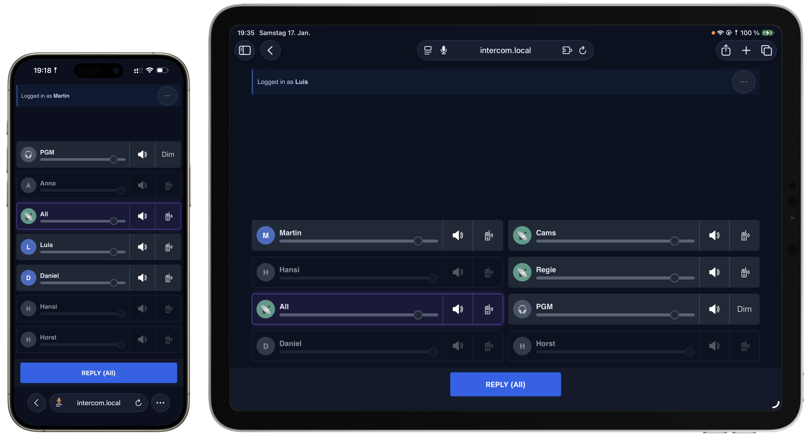

# Talktome

WebRTC intercom app built with Node.js, mediasoup and Socket.IO.



## Community

<a href="https://discord.gg/x5Q27F7HK"></a>

Join our [Discord server](https://discord.gg/x5Q27F7HK) for discussions, questions,
feedback and sharing how you use Talktome.

## Features

- Browser-based intercom with direct targets, conferences, reply and talk lock.
- Native mobile apps for [iOS](https://apps.apple.com/app/id6827440765).
- Admin UI for users, feeds, conferences, target order, network config, RTC port range, backups, Guest login and panel remote control.
- Program feeds audio/video (NDI, OMT, Webcam)
- Camera tally and remote control through Bitfocus Companion, HTTP API, module and keyboard shortcuts.
- Bridge Desktop Application to integrate NDI, OMT, hardware intercom systems, audio interfaces and mixing consoles.
- Headless client that turns a Raspberry Pi (or any small Linux board) into an intercom panel with Elgato Stream Deck keys and dials, GPIO tally and PTT, and a web admin UI.
- Optional multiple-production matrices with scoped users, conferences, feeds and production admins.

## Quick Start

Choose one way to run the application:

- **[macOS / Windows release](https://github.com/thepoison606/talktome/releases)** easiest local install
- **[Docker](https://hub.docker.com/r/thepoison606/talktome)**
- **Source:** for development

The macOS and Windows releases contain the Talktome server installer and the
optional Talktome Bridge app.

### First Start

1. Start Talktome and open the shown HTTPS URL, for example `https://<HOST-IP>/` or `https://<HOST-IP>:8443/` depending on your selected HTTPS port.
2. Accept the browser warning for the self-signed local certificate.
3. Open `/admin` on the same HTTPS URL.
4. Log in with the initial admin account:
   - Username: `admin`
   - Password: `talktom3`
5. Change the admin password when prompted.
6. In Admin, create users, feeds and conferences, then assign targets to the users who should talk to each other.
7. Operators log in at `/` with their user credentials and allow microphone access.

Login names are case-insensitive: `David`, `david`, and `DAVID` identify the same
account. Display names keep their original spelling; passwords remain
case-sensitive. User and feed login names share one namespace. Creating or
renaming either must use a name that is unique after Unicode NFC normalization
and lowercasing.

Existing databases are not renamed or merged. If old users/feeds have conflicting
login names, password login for that name is rejected for every spelling. Rename
the conflicting entries in Admin to distinct names; ID-based login links remain
usable. Configuration imports reject such collisions before replacing any data.

If clients can open the page but audio does not connect, check Admin `Config`,
the announced media address and the RTC port range/firewall rules.

For WAN use, the announced media address must resolve directly to the Talktome
server and the configured RTC UDP range must be forwarded to it. The native
Bridge opens its return-audio NAT mapping automatically; it does not require a
fixed inbound port or a Bridge-side port-forwarding rule.

### Docker

Replace `<HOST-IP>` with the LAN address clients use to reach this host.

Host networking:
```bash
docker pull thepoison606/talktome:latest
docker run -d --restart unless-stopped --name talktome \
  --network host \
  -e PUBLIC_IP=<HOST-IP> \
  -v talktome_data:/data \
  thepoison606/talktome:latest
```

Explicit port publishing:
```bash
docker run -d --restart unless-stopped --name talktome \
  -e PUBLIC_IP=<HOST-IP> \
  -p 8443:8443 -p 8080:8080 \
  -p 40000-49999:40000-49999/udp \
  -p 40000-49999:40000-49999/tcp \
  -v talktome_data:/data \
  thepoison606/talktome:latest
```

Open `https://<HOST-IP>:8443/`. Allow the HTTPS port and the configured RTC port range in your firewall.
The web port defaults to 8443 in containers (443 outside containers). It can be
changed in Admin → Config → Network → Web Access; restart the server and update
Docker port publishing to match. An explicit `PORT` or `HTTPS_PORT` environment
variable overrides the saved port and locks the Admin field.
If the external port differs from the backend port (for example `55443:8443`),
set **Public HTTPS URL** in Web Access to `https://<HOST-IP>:55443` and restart
the server. This URL is used for shared login links and Media Network QR codes
with both built-in HTTPS and reverse-proxy HTTPS. It does not change the backend
port or Docker mapping. Without a public URL, Media Network QR codes use each
active media address and the backend port; login links prefer a usable browser
request address before falling back to a media address.
The Admin `Config` page can restart the server. Docker deployments use their
configured restart policy (as in the examples above).

### macOS Test Builds

Unsigned macOS test builds downloaded from GitHub may be blocked by Gatekeeper.
To remove the quarantine flag once after installing or extracting:

```bash
xattr -dr com.apple.quarantine "/Applications/Talktome Server.app"
xattr -dr com.apple.quarantine "/Applications/Talktome Bridge.app"
```

Use the first command for the Talktome server app and the second command for the
native Bridge app.

### Versioning and releases

Git release tags are the single source of truth for every Server, Bridge,
headless client and Docker build. Create a tag such as `v1.2.5` to produce version `1.2.5`; commits
after the latest tag receive a development version such as `1.2.5-dev.3`.
Package, Cargo and Tauri manifests intentionally contain only the neutral
`0.0.0` placeholder and must not be edited for a release. The shared
`scripts/resolve-build-version.js` resolver supplies the version to local and
GitHub builds.

The displayed Server version comes from the running Git checkout or the
version embedded in the executable/Docker image. `TALKTOME_VERSION` is only a
fallback when neither is available; a stale environment value cannot relabel
an installed build. Custom Docker builds should pass
`--build-arg TALKTOME_VERSION=<resolved-version>` to embed their build version.

### Node.js runtime and standalone builds

Use Node.js 24.22.1 or a newer Node 24 release for source development. CI reads
the version from `.node-version`. The Docker base image and the standalone
targets in `package.json` are pinned to 24.22.1; update these together when
raising the security baseline, including `engines.node`.

Standalone builds use `pkg`'s SEA mode with the official Node.js binary, so
Node security updates do not depend on the availability of patched
`pkg-fetch` binaries. `npm run build:mac_arm64` and `npm run build:win64`
also stage the native SQLite binding and mediasoup worker. The release smoke
tests verify the embedded Node version and server startup. Run the executable
with `--node-version` to inspect its runtime without starting services.

## Repository layout

- `server.js`: stable entry point for `npm start` and packaged server builds.
- `src/server/`: server startup, application logic and supporting modules.
- `tests/`: automated JavaScript tests; run with `npm test`.
- `public/`: browser client, Admin UI and shared browser/server settings models.
- `scripts/`: build, release, container healthcheck and maintenance tools.
- `server-app/` and `bridge-client/`: native desktop applications.
- `headless-client/`: Rust intercom panel for Raspberry Pi and other Linux
  boards, shipped as Debian packages.
- `vendor/`: locally maintained third-party patches.

## Configuration

On first interactive start, Talktome creates `config.json` and asks for:

- HTTPS port
- mDNS hostname, or `off`
- RTC port range: start port and number of ports
- WebRTC media network mode: automatic (all usable adapters), selected adapters, or manual announced IP/hostname

The same settings can be changed later in Admin `Config`.

In automatic media-network mode, Talktome offers every usable non-internal
IPv4 adapter as a WebRTC ICE candidate. Clients on different attached networks
can therefore select the server address they can reach and communicate through
the same Talktome router. Link-local addresses are only used as a fallback when
no regular adapter address is available. Selected-adapter mode offers only the checked adapters and announces their addresses
via mDNS. If one selected adapter is unavailable, the remaining selected adapters
stay usable; other adapters are never added automatically. Manual mode offers one
announced address for NAT-facing deployments.

Useful environment overrides:

- `PORT` / `HTTPS_PORT`: backend UI port (HTTPS by default, HTTP in proxy mode)
- `TALKTOME_TLS_MODE`: `internal` (default, built-in HTTPS) or `proxy` (HTTP backend behind an HTTPS reverse proxy)
- `TALKTOME_PUBLIC_URL`: public HTTPS origin for connection links and QR codes
- `TALKTOME_TRUSTED_PROXIES`: comma-separated proxy IP/CIDR allowlist for forwarded host/protocol and status client-IP headers (falls back to `TALKTOME_SSO_TRUSTED_PROXIES`)
- `HTTP_PORT`: redirect port, or `off`
- `PUBLIC_IP`: manual WebRTC announced address
- `MDNS_HOST`: mDNS hostname, or `off`
- `TALKTOME_MEDIA_INTERFACE`: selected network adapter names, comma-separated (for example `en0,en7`)
- `TALKTOME_MEDIA_INTERNAL_IP`: optional bindable LAN address advertised in addition to `PUBLIC_IP`
- `TALKTOME_RTC_PORT_START` and `TALKTOME_RTC_PORT_COUNT`: RTC range override
- `TALKTOME_ICE_SERVERS_JSON`: browser STUN/TURN servers as standard `RTCIceServer` JSON
- `TALKTOME_ICE_TRANSPORT_POLICY`: browser ICE policy, `all` (default) or `relay`
- `TALKTOME_TURN_URLS`, `TALKTOME_TURN_USERNAME` and `TALKTOME_TURN_CREDENTIAL`: simple TURN-only alternative to the JSON setting
- `TALKTOME_DATA_DIR`: data directory override
- `TALKTOME_CONFIG_PATH`: explicit config file, taking precedence over the project and data-directory configs
- `TALKTOME_SSO_ENABLED`: enable trusted reverse-proxy header SSO (`true`, default: disabled)
- `TALKTOME_SSO_HEADER`: identity header set by the proxy (default: `X-Forwarded-User`)
- `TALKTOME_SSO_TRUSTED_PROXIES`: required comma-separated proxy IP/CIDR allowlist when SSO is enabled
- `COMPANION_API_KEY`: fixed Companion/API key

Changing media-network, RTC-port, browser ICE or SSO environment settings requires a server restart. Guest login changes apply immediately.

## HTTPS reverse proxy

Select **Admin → Config → Web access → HTTPS via reverse proxy**, or set
`TALKTOME_TLS_MODE=proxy`. The backend port remains `PORT` / `HTTPS_PORT`
(or the saved backend port); in proxy mode it serves HTTP, including Socket.IO,
and both HTTP-to-HTTPS redirects are disabled. No local TLS certificate is needed.
The default mode remains built-in HTTPS.

Web access settings are saved in `config.json` as `tlsMode`, `httpsPort`,
`publicUrl` and `trustedProxies`. Environment variables take precedence and lock
individual fields in Admin. Changes require a server restart.

Example Docker environment (backend port 8443):

```yaml
environment:
  TALKTOME_TLS_MODE: proxy
  PORT: 8443
  MDNS_HOST: off
  TALKTOME_PUBLIC_URL: https://talktome.example.com
  TALKTOME_TRUSTED_PROXIES: 172.20.0.2
```

Use the actual reverse-proxy IP or a restricted proxy network CIDR for the
allowlist. The proxy must overwrite forwarded headers. Without a trusted proxy,
forwarded host/protocol headers are ignored; the configured public URL still
provides the correct QR and connection links.

The Status page uses this allowlist to resolve user, feed and Companion client
IPs from `X-Forwarded-For`. Proxy chains are checked from the server towards the
client and stop at the first untrusted hop. Headers supplied by an untrusted
peer are ignored.

Example Nginx location inside your HTTPS virtual host (with a certificate
configured on Nginx):

```nginx
location / {
    proxy_pass http://talktome:8443;
    proxy_http_version 1.1;
    proxy_set_header Host $host;
    proxy_set_header X-Forwarded-Host $http_host;
    proxy_set_header X-Forwarded-Proto https;
    proxy_set_header X-Forwarded-For $remote_addr;
    proxy_set_header Upgrade $http_upgrade;
    proxy_set_header Connection "upgrade";
    proxy_read_timeout 3600s;
    proxy_buffering off;
}
```

Browsers must access the **public HTTPS URL**: microphone access and secure
session cookies require it. Keep the HTTP backend private. WebRTC media still
uses the configured RTC ports directly (or TURN); an HTTP reverse proxy does
not forward those media ports. Configure the media network and firewall as usual.

## HTTP request limits

The server applies per-client-IP HTTP limits before parsing JSON or accessing
files: 6000 requests/minute overall, 600/minute for Admin and legacy user/feed/
conference routes (including the Panel), and 2400/minute for `/api` routes.
Login POSTs share a quota of 30 failed requests per 15 minutes across user,
feed, token, guest, SSO, Admin and Companion logins. Successful logins do not
consume that quota. Excess requests return HTTP `429` with `Retry-After`.

Client IPs use the same trusted-proxy allowlist as the Status page; untrusted
forwarded headers cannot change the quota key. IPv6 addresses are grouped by
`/56` subnet. Limits are shared by clients behind one NAT address. Configure
`trustedProxies` correctly behind a reverse proxy so unrelated clients do not
all share its quota. Counters are held in memory per server process and reset
on restart. Existing SSE streams and WebRTC audio/video are not interrupted
when an HTTP quota is reached; Socket.IO messages are outside these HTTP limits.

## Data

State is stored in SQLite `app.db`; config, certificates and generated API keys live in the same app data directory.

- macOS: `~/Library/Application Support/talktome`
- Windows: `%LOCALAPPDATA%\talktome`
- Linux: `$XDG_DATA_HOME/talktome` or `~/.local/share/talktome`
- Override: `TALKTOME_DATA_DIR=/path/to/data`

Back up this directory before upgrades if you need to preserve accounts and routing.

Admin → Config → Backup and restore can also write automatic JSON configuration backups to the `backups` subdirectory of this app data directory. This is off by default; choose an interval of 1, 3, 7, 14 or 30 days. Enabling it creates the first backup immediately. Backups are retained until you remove them.


## Users, Feeds And Guests

- Operators log in at `/` and can talk to assigned users/conferences.
- Feeds log in at `/`, publish their assigned feed, and cannot talk back. Browser feeds can optionally publish a webcam; web users open the picture above the feed controls using its camera icon. See [browser video feeds](docs/browser-video-feeds.md).
- Guests are enabled in Admin `Config`.
- All Guests share the targets and conference memberships of the generated `Guest` profile.
- The Guest profile in Admin `Users` provides a shareable login URL and QR code; Guests still choose their own display name when opening it.
- Guest profiles cannot be direct targets, admins, deleted, or password-reset.
- Online Guests can still be answered through `Reply`.
- Guest login is passwordless and stored only in browser `sessionStorage`, so page refresh keeps it, but closing the browser session clears it.

## Trusted reverse-proxy SSO

The first SSO integration stage supports an authentication proxy such as
Traefik ForwardAuth or oauth2-proxy. It is disabled by default. To enable it:

```text
TALKTOME_SSO_ENABLED=true
TALKTOME_SSO_HEADER=X-Forwarded-User
TALKTOME_SSO_TRUSTED_PROXIES=172.18.0.0/16,127.0.0.1
```

The proxy-provided identity is matched case-insensitively against a unique
existing Talktome username. Talktome does not provision users automatically.
Unknown identities, Guest profiles and Super Admins fall back to the normal
login page. Because the username is the chosen mapping key, renaming it in
Talktome or changing the upstream identity breaks the mapping until both values
match again.

Only direct connections from `TALKTOME_SSO_TRUSTED_PROXIES` may supply the
identity header. The Talktome backend must not be directly reachable by clients,
and the reverse proxy must replace or remove any client-supplied copy of the
configured header. Browser and Socket.IO registrations are backed by the same
HttpOnly server session; a client cannot select a different user ID locally.

SSO applies to operator login at `/`. Feeds, Guests, Admin, Companion and Bridge
retain their existing authentication paths. Browser sessions are held in memory
for 12 hours and are invalidated by a server restart; with SSO, the next page
load creates a new session automatically. Logging out of Talktome does not end
the upstream identity-provider session, so a reload can sign the user in again.

## Matrix and Productions

The Admin `Matrix` page always contains the existing `Default` target and
conference-membership matrices. Conference membership automatically provides
the matching conference target button, so it does not need to be assigned a
second time.

Enable `Multiple Productions` on that page to add separate Production layouts.
Each Production explicitly contains users, conferences and feeds and has its own
conference memberships, target assignments and button order. Users assigned to
one or more Productions can choose one of their assigned Productions after login
and can switch from the application menu. A missing selection falls back to an
actual membership; users without any Production receive a clear assignment error.

Conference identities remain global and may span Productions. Routing uses each
connected user's currently loaded Production: speaking to a conference reaches
all active users whose current Default or Production membership includes that
conference, even when those users loaded different Productions. Direct user
targets likewise reach the user's active session across Productions, and Reply
can address a caller absent from the recipient's current target list. A user has
only one active Talktome session at a time.

Production admins may manage the contents, memberships and matrix of their own
Productions without access to global users, server config, backups or other
Productions. Only global admins may enable the feature, create, rename or delete
Productions, or assign Production admins. Bridge endpoints, Bridge feeds and
personal mute/volume settings remain global and do not select a Production.
Bridge automatic Talk targets (Audio level / Always on) can select any user or conference on the server. Selected
conferences also supply return audio. These targets appear as gray, managed
Matrix crosspoints wherever both endpoints are present; click a gray point to
open its Bridge configuration. Existing manual assignments survive removal of
the corresponding Bridge target.

## Companion and HTTP API

Companion module source is maintained separately:
`https://github.com/bitfocus/companion-module-talktome-intercom.git`

Auth:

- API key via `x-api-key: <KEY>` or `Authorization: Bearer <KEY>`
- User-scoped token via `POST /api/v1/companion/auth/login`

Main endpoints:

- `GET /api/v1/companion/config`
- `GET /api/v1/companion/state`
- `GET /api/v1/companion/users`
- `GET /api/v1/companion/conferences`
- `GET /api/v1/companion/feeds`
- `GET /api/v1/companion/users/:id/targets`
- `POST /api/v1/companion/users/:id/talk`
- `POST /api/v1/companion/users/:id/target-audio`
- Legacy: `POST /users/:id/talk`

Production-aware Companion clients receive the available Productions in the
login/config response. Pass `productionId` as a query parameter to the state,
users, conferences, feeds and targets endpoints, and as Socket.IO auth data for
a filtered snapshot and event stream. Omitting it selects the primary Production;
when Multiple Productions is disabled, an explicitly supplied value is ignored.

Socket.IO namespace: `/companion` with `snapshot`, `user-state`, `command-result`, and `cut-camera` events.

Guest profiles are intentionally hidden from Companion and cannot be controlled as direct targets.

### Enabling SSO

To use SSO, configure the authentication proxy to remove any client-supplied
copy of the identity header and, after successful authentication, set
`X-Forwarded-User` (or the header selected with `TALKTOME_SSO_HEADER`) to the
name of an existing Talktome user (case-insensitive). Enable SSO with
`TALKTOME_SSO_ENABLED=true`, add the proxy IP or network to
`TALKTOME_SSO_TRUSTED_PROXIES`, and ensure clients cannot reach the Talktome
backend without passing through that proxy. No user synchronization or
automatic provisioning is required; unknown identities see the normal login
page.

## Camera Tally

```bash
curl -X POST https://<IP>:<PORT>/cut-camera \
  -H "Content-Type: application/json" \
  -d '{"user":"<USERNAME>","bus":"pgm","productionId":1}'
```

`pgm` turns the matching user UI red and `prv` turns it green. Tally is scoped to
the selected Production. Omit `bus` for the legacy PGM behavior; omit
`productionId` to use the primary Production. Send an empty `user` to clear the
selected bus. The legacy `cutCameraUser` snapshot field remains available for PGM.

## Shortcuts

- `Space`: Reply
- Number keys: talk to targets in list order
- Set your own hotkeys in the menu

## Native Bridge App

Talktome Bridge is the optional macOS/Windows tray app for connecting local
audio interfaces such as Dante Virtual Soundcard, NDI, OMT and other
CoreAudio/WASAPI devices. Developer and packaging notes live in
`bridge-client/README.md`.

The Bridge also supports NDI® Audio without bundling proprietary NDI
software. Install the current [NDI Runtime](https://ndi.video/for-developers/) for this feature. Discovered NDI
sources then appear as input devices, while `Talktome Bridge 1` through
`Talktome Bridge 8` appear as stereo NDI output devices. Select them for a
managed Bridge port exactly like a local audio interface. The initial
implementation accepts uncompressed 48 kHz floating-point NDI audio; NDI HX and
compressed Advanced SDK audio are not supported. The runtime can alternatively
be selected explicitly with `TALKTOME_NDI_RUNTIME=/path/to/libndi`.

NDI® is a registered trademark of Vizrt NDI AB. Talktome does not distribute
the NDI SDK, NDI Runtime or NDI Tools; installing the runtime is subject to
NDI's own license terms.

The Bridge also includes royalty-free Open Media Transport (OMT) Audio support.
No separate runtime is required. Discovered OMT sources can be selected as
Bridge inputs, and eight `Talktome Bridge N` stereo OMT send slots are available
as outputs. OBS 31 or newer can send and receive them using the official
[OMT plugin](https://github.com/openmediatransport/omtplugin). Setup and network
requirements are documented in the Bridge client's
[OMT Audio documentation](bridge-client/README.md#omt-audio).

## Headless Client

`talktome-headless` logs in as a normal Talktome user and runs without a
screen: an Elgato Stream Deck (MK.2, XL, Mini, Neo, +, + XL, Pedal) serves as
the key panel with talk, reply, locks, volume and conference member mix; GPIO
lines carry PGM/PRV tally, talk and status lights and PTT inputs; a local web
UI covers status, settings and a remote control. It is built as `.deb`
packages for arm64, armhf and amd64 by the Headless Client Builds workflow.
Installation, configuration and the Stream Deck layout are described in
[headless-client/README.md](headless-client/README.md); protocol and design
details are in
[headless-client/specification.md](headless-client/specification.md).
